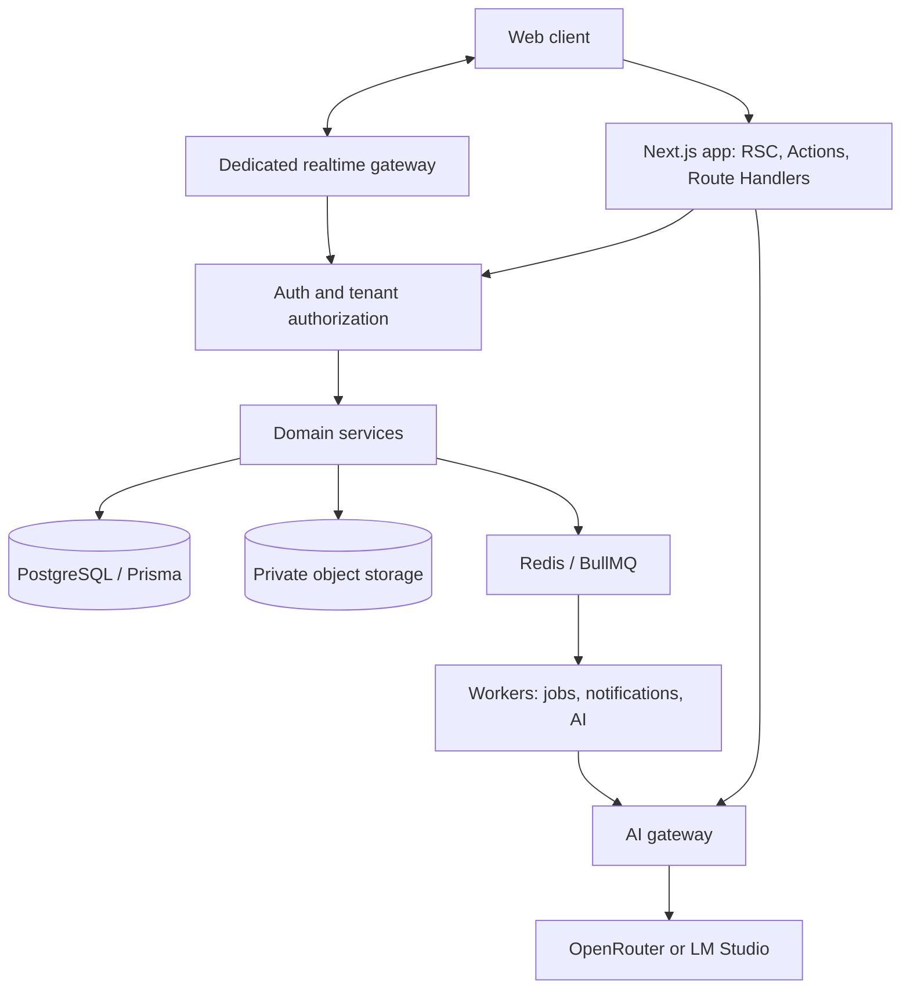

# 02 — System Architecture

## Architecture decision
Start with a **modular monolith** in Next.js App Router, backed by PostgreSQL. Run realtime gateway and asynchronous workers as independent services. Split domains into microservices only when operational metrics justify it.



## Boundaries
- **Client:** presentation, local form state, optimistic UI; no secrets or privileged queries.
- **Next.js server:** validated routes/actions, auth and tenancy, application services.
- **Domain modules:** goals, tasks, organizations, collaboration, knowledge, CRM, gamification, AI, billing.
- **Prisma/PostgreSQL:** transactional truth, constraints and indexes.
- **Redis/worker:** retries, scheduling, notifications, long-running AI/document jobs.
- **Realtime gateway:** authenticated room membership, chat events and presence; never rely on UI filtering.
- **AI gateway:** provider abstractions, policy checks, usage accounting, audit, content safety and tool approvals.

## Example request flow — create task
1. Client submits form or calls server action.
2. Validate session and resolve organization membership from server context.
3. Validate payload using Zod.
4. Authorize `task:create` within project/goal scope.
5. Verify referenced goal and assignee belong to organization.
6. Execute transaction and emit event/outbox record.
7. Worker sends notification; UI refreshes.

## Folder conventions
```
src/
  app/[locale]/(workspace)/[organizationSlug]/...
  app/api/...
  features/{organizations,goals,tasks,chat,ai,...}/
    components/
    schemas/
    server/
    __tests__/
  components/{ui,layout,shared}/
  lib/{auth,db,permissions,storage,ai}/
  server/{services,repositories}/
  i18n/
prisma/
workers/
tests/
docs/
```

## Deployment proposal
- Docker Compose on VPS for pilot: reverse proxy/TLS, Next.js app, separate worker, gateway, PostgreSQL, Redis, private object store or managed compatible service.
- Prefer managed database/backups if the team lacks database operations coverage.
- Isolate local LM Studio provider with secure network access; do not expose its endpoint to public clients.
- Configure tracing, metrics, structured logs, error monitoring and health checks.

## Scale & reliability
- DB composite indexes on `(organization_id, ...)`.
- Paginate lists and chat history; batch notification fanout.
- Separate CPU-heavy transcription or ingestion jobs.
- Idempotent consumers with bounded retries and dead-letter handling.
- Avoid storing blobs in PostgreSQL; store object references and metadata.
- Use outbox/event publication for critical cross-process events.

## Decision checkpoints
Version compatibility for Next.js, Prisma, Better Auth, AI SDK, Redis and websocket deployment must be verified against current official docs at build time.
